<h1 align="center">ShopFlow – Project Overview</h1>

## Tools: PostgreSQL + DBeaver, Microsoft Excel, Copilot

The data comes from a simulated online store called ShopFlow, operating in the Polish e-commerce market across the fashion, electronics, home & living, and beauty sectors. The dataset contains approximately 85,000 records distributed across five related tables. The data covers 24 months of sales history and intentionally includes common real-world data quality issues such as duplicates, missing values, inconsistent formats, and outliers. These issues were identified and resolved as part of the project.

## Data Structure

| Table | Number of Records | Contents |
|---------|---------:|---------|
| customers | ~5,000 | Customer data, including location, acquisition channel, registration date, and loyalty program membership |
| products | ~2,000 | Product catalog containing category, brand, price, cost, and date added to the assortment |
| orders | ~20,000 | Order headers, including customer, order date, status, payment method, order value, and marketing channel |
| order_items | ~49,000 | Order line items, including product, quantity, purchase price at the time of sale, and discount |
| inventory | 2,000 | Inventory records, including stock quantity, replenishment threshold, and warehouse location |


## Business Context: 
ShopFlow is an online retailer operating in the Polish e-commerce market, offering products across eight categories: women's fashion, men's fashion, home & living, electronics, beauty, sports, children, and accessories. The sales data covers 24 months of the company's operations and exhibits clear seasonal trends, including increased sales during November and December (driven by Black Friday and the holiday shopping season) as well as a noticeable decline in January.


## Data Characteristics: 
The dataset was designed to reflect the data quality challenges commonly encountered in real-world transactional systems. It includes duplicate records, missing values, inconsistent formats (dates, phone numbers, postal codes, city names, and product categories)and price outliers. All of these issues were identified and resolved during the data cleaning phase of the project using SQL and PostgreSQL before proceeding with the main business analysis.


## Business Problem: 
The company is experiencing steady growth but faces several important business challenges:
- Increasing Customer Acquisition Cost (CAC)
- Low customer retention
- Inventory management issues
- Lack of visibility into product and category profitability
- Inconsistent reporting across departments
- Inexplicable allocation of marketing expenditures

Additionally, only approximately 22% of customers place a second order within six months of their first purchase.

## Project Objective

The objective of this project was to perform a complete analytical workflow consisting of:

1.	Data quality assessment.
2.	Data cleaning and standardization.
3.	Identification of data quality issues.
4.	Exploratory business analysis.
5.	Generation of actionable business recommendations.

## <h1 align="center">DATA PROFILING</h1>

## <h1 align="center">1. TABLE SIZE ASSESSMENT</h1>

SELECT COUNT(*) FROM customers; -- 5150

SELECT COUNT(*) FROM products; -- 2000

SELECT COUNT(*) FROM orders; -- 20400

SELECT COUNT(*) FROM order_items; -- 50000

SELECT COUNT(*) FROM inventory; -- 2000


The dataset size is sufficient to perform meaningful data quality and business analyses.


## <h1 align="center">2. IDENTIFYING MISSING DATA AND SUSPICIOUS DATA</h1>

## -- MISSING PHONE NUMBERS WERE IDENTIFIED IN THE CUSTOMER DATABASE.
```
SELECT *
FROM customers
WHERE PHONE IS null OR PHONE = ''; 
```
-- At this stage, phone numbers were not removed or artificially completed because there was insufficient information to determine the correct values.
Records were temporarily marked as "UNKNOWN" and flagged for future business verification. Maintaining these records preserves potentially valuable customer information while ensuring data transparency. Correct phone numbers may improve customer service, marketing effectiveness, and communication quality.
```
update customers c 
set PHONE = 'UNKNOWN'
where PHONE is null or PHONE = '';
```

## -—INVENTORY DASHBOARD: INFENTIFIED MISSING STOCK QUANTITY
```
select *
from inventory i
where i.stock_quantity <=0; 
```
-- Products with inventory levels equal to or below zero were detected. 
```
select COUNT(i.stock_quantity)
from inventory i
where i.stock_quantity <=0; 
```
-- 126 affected records 
```
alter table inventory 
add column VERIFY_STOCK_QUANTITY BOOLEAN default false; 
```
-- Adding the VERIFY_STOCK_QUANTITY flag allows suspicious records to be tracked and reviewed in later stages of the analysis. This helps investigate why products have zero or negative stock levels,
dentify potential inventory management issues, and support future business verification.
```
update INVENTORY  set VERIFY_STOCK_QUANTITY = true where stock_quantity <= 0; 
```
<p align="center">
  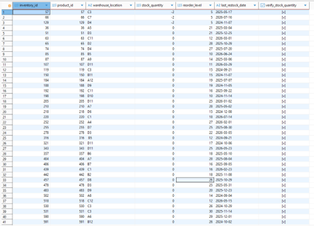
</p>

## --PRODUCTS DASHBOARD: INVALID PRODUCTS PRICE HAVE BEEN FOUND (<=0)
 ```
select * from products p where p.unit_price <= 0; 
```
-- Products with prices equal to zero or below zero were identified.
```
ALTER table PRODUCTS
add column VERIFY_UNIT_PRICE BOOLEAN default false; 
```
-- Products with invalid prices were not removed. Instead, they were marked for further business investigation.  This allows suspicious records to be reviewed later, helping identify potential pricing errors or data entry issues .
```
UPDATE PRODUCTS set VERIFY_UNIT_PRICE = true where UNIT_PRICE <=0; 
```
<p align="center">
  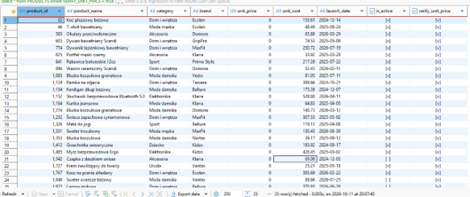
</p>

## -- ORDER_ITEMS DASHBOARD: ORDER_QUANTITY RESULTS ARE NEGATIVE
```
select * from order_items oi where oi.quantity <0; 
```
-- Negative order quantities were detected in the order items table. Possibile explanations: product returns, refund processing, incorrect transaction data
```
ALTER table order_items 
add column VERIFY_QUANTITY BOOLEAN default false;
```
```
update ORDER_ITEMS set VERIFY_QUANTITY = true where QUANTITY < 0; 
```
-- All suspicious records were flagged for future investigation rather than removed from the dataset.

## -- ORDERS DASHBOARD: Customers with no orders
```
SELECT c.customer_id, c.email, c.registration_date
FROM customers c
LEFT JOIN orders o ON c.customer_id = o.customer_id
WHERE o.order_id IS NULL;
```
-- Identifies customer accounts that have never placed an order. The results were saved as a view for further analysis and verification. 
```
CREATE VIEW klienci_bez_zamowien AS
SELECT c.*
FROM customers c
LEFT JOIN orders o ON c.customer_id = o.customer_id
WHERE o.order_id IS NULL;
```

Not all irregular records should be automatically removed or corrected.
Where sufficient business context was unavailable, records were flagged for review in order to preserve potentially valuable information while maintaining data transparency.

## -- ORDER_ITEMS DASHBOARD: PRODUCT_ID FROM ORDER_ITEMS NOT PRESENT IN PRODUCTS DASHBOARD
```
SELECT oi.*
FROM order_items oi
LEFT JOIN products p ON oi.product_id = p.product_id
WHERE p.product_id IS NULL;
```
-- Identifies order items that reference products not present in the products table.
```
INSERT INTO products (product_id, product_name, category, brand, unit_price, unit_cost, is_active)
VALUES (-1, 'Produkt zarchiwizowany / brak danych', 'Nieznana', 'Nieznana', 0, 0, FALSE);
```
```
UPDATE order_items oi
SET product_id = -1
WHERE NOT EXISTS (SELECT 1 FROM products p WHERE p.product_id = oi.product_id);
```
--Some order items referenced products that were not present in the products table. To preserve historical sales records a placeholder product was created and assigned to orphaned records.


## <h1 align="center">3. DATA STANDARDIZATION</h1>

## -- INVENTORY DASHBOARD: contained leading and trailing spaces, resulting in inconsistent location names.

```
UPDATE inventory
SET warehouse_location = TRIM(warehouse_location);
```
-- All warehouse location values were standardized by removing unnecessary spaces in order to track valid data and correct analysis.


## --CUSOMERS DASHBOARD: Customer email addresses contained inconsistencies such as:Uppercase letters, leading spaces, trailing spaces

<p align="center">
  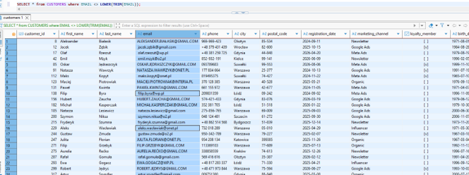
</p>

```
SELECT * from CUSTOMERS where EMAIL <> LOWER(TRIM(EMAIL));
```
-- Identifying the Issue
```
update CUSTOMERS set EMAIL = LOWER(TRIM(EMAIL)); 
```
-- All email addresses were converted to lowercase and stripped of unnecessary spaces. Email standardization improves customer identification and reduces the risk of duplicate records caused by formatting differences or invalid analysis . 

 <p align="center">
  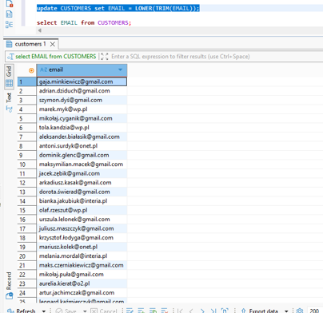
</p>


## -- CUSTOMERS DASHBOARD: Phone Number Standardization

 <p align="center">
  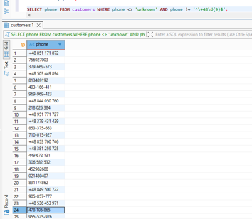
</p>
 
```
SELECT phone FROM customers WHERE phone <> 'unknown' AND phone !~ '^\+48\d{9}$';
```
-- Customer phone numbers appeared in multiple formats such as country code prefix (+48), spacers, dashes
```
update customers c set PHONE = '+48' || RIGHT(REGEXP_REPLACE(phone, '[^0-9]', '', 'g'), 9)
where PHONE <> 'UNKNOWN'
and LENGTH(REGEXP_REPLACE(phone, '[^0-9]', '', 'g')) >= 9; 
```
-- Phone numbers were converted into a unified format: +48123456789
Consistent phone number formatting improves customer communication and increases data reliability across CRM and marketing systems.

  <p align="center">
  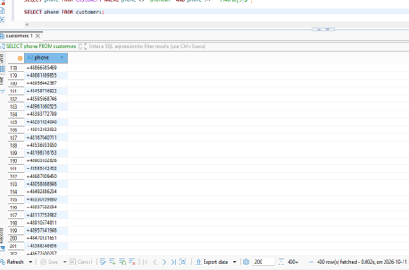
</p>

## -- CUSTOMERS DASHBOARD: Postal Code Standardization (XX-XXX)

  <p align="center">
  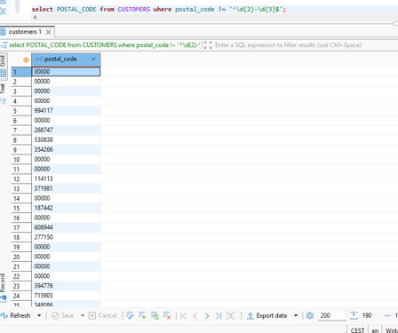
</p>

```
select POSTAL_CODE from CUSTOMERS where postal_code !~ '^\d{2}-\d{3}$'; 
```
-- Identifying Invalid Postal Codes

```
update customers
set POSTAL_CODE = null
where POSTAL_CODE = '00000'; 
```
-- Placeholder values such as were replaced with NULL because they do not represent valid postal codes.

```
SELECT COUNT(*), postal_code
FROM customers
WHERE postal_code !~ '^\d{2}-\d{3}$'
GROUP BY postal_code; 
```
-- After the initial cleanup, 94 records still contained invalid postal codes: 'XXXXXX'
```
ALTER table customers 
add column VERIFY_POSTAL_CODE BOOLEAN default false; 
```
-- Because there was insufficient information to determine the correct values, these records were flagged for future verification. Correct postal code can improve delivering process.
```
update CUSTOMERS set VERIFY_POSTAL_CODE = true where postal_code !~ '^\d{2}-\d{3}$';
```
  <p align="center">
  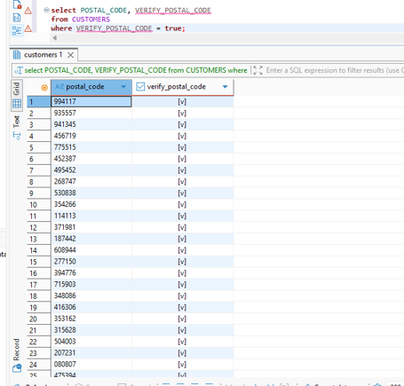
</p>


## -- CUSTOMERS DASHBOARD: City Name Standardization

 <p align="center">
  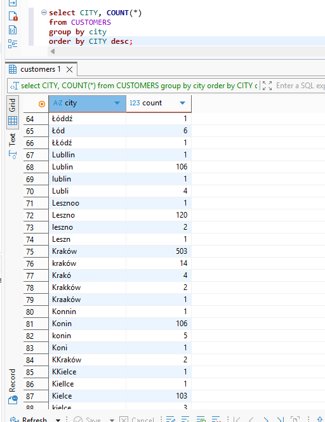
</p>

 ```
select CITY, COUNT(*)
from CUSTOMERS
group by city 
order by CITY desc; 
```
-- The city column contained numerous inconsistencies: Typographical errors, different capitalization, duplicate city names
Examples:
warszawa
Warszawa
warszaawa
warszzawa
warszawa
These values all referred to the same city.


```
CREATE TABLE city_mapping (
  wariant     VARCHAR(50) PRIMARY KEY,
  kanoniczna  VARCHAR(50)
);
```
-- A reference table (wariant)was created to map incorrect city names to a standardized business-approved version (kanoniczna)

```
INSERT INTO city_mapping (wariant, kanoniczna) VALUES
  -- Warszawa
  ('warszawa', 'Warszawa'), ('warszaw', 'Warszawa'), ('wwarszawa', 'Warszawa'),
  ('warszzawa', 'Warszawa'), ('warszawwa', 'Warszawa'), ('warszaawa', 'Warszawa'),
  ('warsszawa', 'Warszawa'), ('waarszawa', 'Warszawa'), ('warrszawa', 'Warszawa'),
  ('warszawaa', 'Warszawa'),
  -- Kraków
  ('kraków', 'Kraków'), ('krakó', 'Kraków'), ('kkraków', 'Kraków'),
  ('krakków', 'Kraków'), ('kraaków', 'Kraków'),
.
.
.
ON CONFLICT (wariant) DO NOTHING;
```
```
update customers c set CITY = CITY_MAPPING.KANONICZNA
from CITY_MAPPING
where LOWER(C.CITY) = CITY_MAPPING.WARIANT; 
```
-- All detected city name variations were standardized to a single canonical version.
City normalization enables accurate geographic analysis

  <p align="center">
  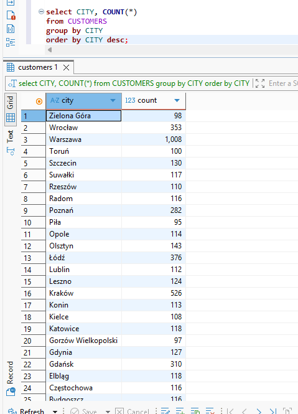
</p>

## -- ORDERS DASHBOARD: DATE STANDARDIZATION
```
SELECT order_date FROM orders WHERE order_date !~ '^\d{4}-\d{2}-\d{2}$' LIMIT 20;
```
-- The order_date column contained multiple date formats, which could lead to inconsistencies and errors during analysis
```
UPDATE orders
SET order_date = TO_CHAR(TO_DATE(order_date, 'DD.MM.YYYY'), 'YYYY-MM-DD')
WHERE order_date ~ '^\d{2}\.\d{2}\.\d{4}$';
```
```
UPDATE orders
SET order_date = TO_CHAR(TO_DATE(order_date, 'DD/MM/YYYY'), 'YYYY-MM-DD')
WHERE order_date ~ '^\d{2}/\d{2}/\d{4}$';
```
-- Date values stored in formats DD.MM.YYYY and DD/MM/YYYY were converted to the ISO standard format YYYY-MM-DD to ensure consistency across the dataset and correct futher analysis.


## <h1 align="center">4. DUPLICATE REMOVAL AND CATEGORY STANDARDIZATION</h1>


## -- CUSTOMERS DASHBOARD:  Identifying Duplicate Customer Email Addresses

  <p align="center">
  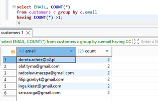
</p>
  <p align="center">
  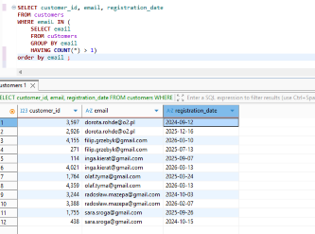
</p>

```
SELECT customer_id, email, registration_date 
FROM customers
WHERE emaiL IN (
    SELECT email
    FROM cuStomers
    GROUP BY email
    HAVING COUNT(*) > 1)
order by email ; 
```
-- Duplicate customer accounts were detected based on identical email addresses.
Duplicate customer records can cause inaccurate customer counts, duplicated marketing communication.
```
WITH ranked AS (
  SELECT
    customer_id,
    LOWER(TRIM(email)) AS email_norm,
    ROW_NUMBER() OVER (
      PARTITION BY LOWER(TRIM(email))
      ORDER BY registration_date ASC, customer_id ASC
    ) AS rn
  FROM customers
),
mapowanie AS (
  SELECT r_dup.customer_id AS stary_id, r_keep.customer_id AS nowy_id
  FROM ranked r_dup
  JOIN ranked r_keep ON r_dup.email_norm = r_keep.email_norm AND r_keep.rn = 1
  WHERE r_dup.rn > 1
)
UPDATE orders o
SET customer_id = m.nowy_id
FROM mapowanie m
WHERE o.customer_id = m.stary_id;
```
```
WITH ranked AS (
SELECT customer_id,
         ROW_NUMBER() OVER (
           PARTITION BY LOWER(TRIM(email))
           ORDER BY registration_date ASC, customer_id ASC
         ) AS rn
  FROM customers
)
DELETE FROM customers WHERE customer_id IN (SELECT customer_id FROM ranked WHERE rn > 1);
```
-- Removing duplicate customer records directly could result in losing the relationship between customers and their orders.
To prevent data loss, all orders belonging to duplicate customers were reassigned to the primary customer account.
The oldest customer account was retained while all orders from duplicate accounts were reassigned to the retained customer record.

```
SELECT LOWER(TRIM(email)) AS email_norm, COUNT(*)
FROM customers
GROUP BY LOWER(TRIM(email))
HAVING COUNT(*) > 1;
```
-- No duplicate email records remained after the cleanup process.

## -- CUSTOMERS DASHBOARD: While investigating duplicate phone numbers, several customer accounts were discovered with email addresses containing the suffix: _dup

 <p align="center">
  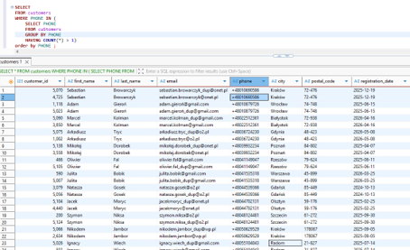
</p>

 ```
SELECT *
FROM customers
WHERE PHONE IN (
    SELECT PHONE
    FROM cuStomers
    GROUP BY PHONE
    HAVING COUNT(*) > 1)
order by PHONE ; 
```
-- Identifying Affected Records
```
SELECT c.customer_id, c.email, COUNT(o.order_id) AS liczba_zamowien
FROM customers c
LEFT JOIN orders o
    ON c.customer_id = o.customer_id
WHERE c.email ILIKE '%_dup@%'
GROUP BY c.customer_id, c.email
ORDER BY liczba_zamowien DESC; 
```
-- Before removing duplicate accounts, it was necessary to determine whether they had associated orders. Duplicate customer accounts contained associated orders.
```
UPDATE orders o
SET customer_id = orig.customer_id
FROM customers dup
JOIN customers orig
    ON REPLACE(dup.email, '_dup@', '@') = orig.email
WHERE o.customer_id = dup.customer_id;
```
-- All orders associated with duplicate accounts were reassigned to the corresponding original customer accounts.

DELETE FROM customers
WHERE email ILIKE '%_dup@%';
All unnecessary duplicate customer records were removed while maintaining order integrity.
## -- PROCUDTS DASHBOARD: Product Category Standardization

 <p align="center">
  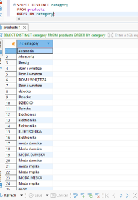
</p>

```
SELECT DISTINCT category 
FROM products 
ORDER BY category;
```
-- The category field contained multiple representations of the same business category.
Examples:
electronics
Electronics
ELEKTRONIKA
Elektronika
```
UPDATE products SET category = 'Elektronika'   WHERE LOWER(TRIM(category)) IN ('elektronika', 'electronics');
UPDATE products SET category = 'Moda damska'   WHERE LOWER(TRIM(category)) IN ('moda damska', 'women fashion');
UPDATE products SET category = 'Moda męska'    WHERE LOWER(TRIM(category)) = 'moda męska';
UPDATE products SET category = 'Dom i wnętrza' WHERE LOWER(TRIM(category)) = 'dom i wnętrza';
UPDATE products SET category = 'Uroda'         WHERE LOWER(TRIM(category)) IN ('uroda', 'beauty');
UPDATE products SET category = 'Sport'         WHERE LOWER(TRIM(category)) = 'sport';
UPDATE products SET category = 'Dziecko'       WHERE LOWER(TRIM(category)) = 'dziecko';
UPDATE products SET category = 'Akcesoria'     WHERE LOWER(TRIM(category)) = 'akcesoria';
```
-- All category names were standardized into a single business-approved taxonomy. Category-level reporting became consistent and reliable. Non-standardized categories can lead to inaccurate analyses and misleading business conclusions. For example, metrics such as profit, revenue, return rates, or sales performance by category may be distorted if products are assigned inconsistently across categories.

 <p align="center">
  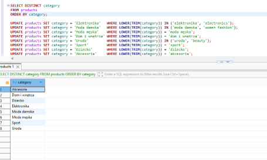
</p>
 
## -- PRODUCTS DASHBOARD: Outlier Price Detection

```SELECT *
FROM products
ORDER BY unit_price DESC
LIMIT 20;
```
-- Several products contained unusually high prices compared to typical products within their category. 


```UPDATE products
SET verify_unit_price = true
WHERE unit_price <= 0
   OR unit_price > 4500;
```
-- Rather than automatically correcting prices, suspicious records were flagged for further business investigation. Potential pricing errors were isolated while preserving the original data for future validation. Unusually high or low unit prices may skew metrics such as average sales, revenue, and profitability. Outlier detection helps identify potential pricing errors in the system while preserving the original data for further review.

## <h1 align="center">Project Continuation</h1>

This repository focuses on data quality assessment and cleaning. The cleaned dataset was then used for business analysis and strategic recommendations.

🔗 Next stage:  [SHOPFLOW-DATA-ANALYSIS](https://github.com/asiawaldoch/SHOPFLOW-DATA-ANALYSIS)
