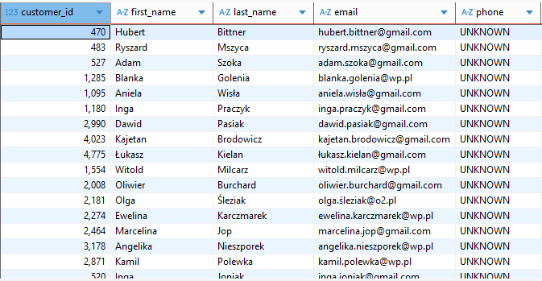
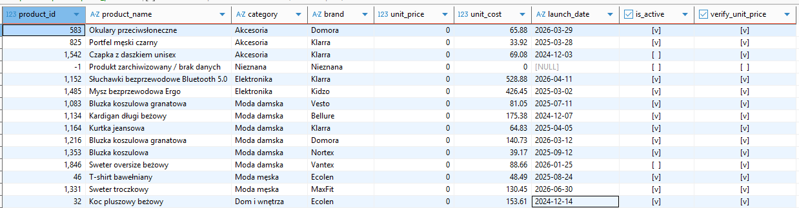
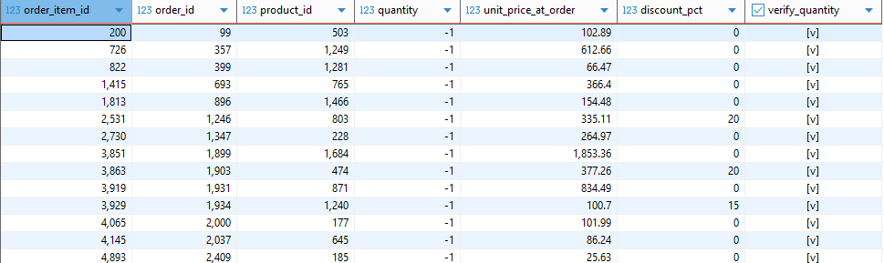
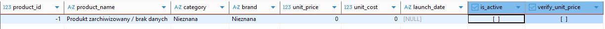

<h1 align="center">ShopFlow – Project Overview</h1>

## Tools: PostgreSQL + DBeaver, Microsoft Excel, Copilot

The data comes from a simulated online store called ShopFlow, operating in the Polish e-commerce market across the fashion, electronics, home & living, and beauty sectors. The dataset contains approximately 85,000 records distributed across five related tables. The data covers 24 months of sales history and intentionally includes common real-world data quality issues such as duplicates, missing values, inconsistent formats, and outliers. These issues were identified and resolved as part of the project.

## Data Structure

| Table | Number of Records | Contents |
|---------|---------:|---------|
| customers | ~5,000 | Customer data, including location, acquisition channel, registration date, and loyalty program membership |
| products | ~2,000 | Product catalog containing category, brand, price, cost, and date added to the assortment |
| orders | ~20,000 | Order headers, including customer, order date, status, payment method, order value, and marketing channel |
| order_items | ~49,000 | Order line items, including product, quantity, purchase price at the time of sale, and discount |
| inventory | 2,000 | Inventory records, including stock quantity, replenishment threshold, and warehouse location |


## Business Context: 
ShopFlow is an online retailer operating in the Polish e-commerce market, offering products across eight categories: women's fashion, men's fashion, home & living, electronics, beauty, sports, children, and accessories. The sales data covers 24 months of the company's operations and exhibits clear seasonal trends, including increased sales during November and December (driven by Black Friday and the holiday shopping season) as well as a noticeable decline in January.


## Data Characteristics: 
The dataset was designed to reflect the data quality challenges commonly encountered in real-world transactional systems. It includes duplicate records, missing values, inconsistent formats (dates, phone numbers, postal codes, city names, and product categories)and price outliers. All of these issues were identified and resolved during the data cleaning phase of the project using SQL and PostgreSQL before proceeding with the main business analysis.


## Business Problem: 
- **Rising Customer Acquisition Cost (CAC)**  
  Customer acquisition cost has increased by 34% year-over-year, while the marketing team lacks clear visibility into which channels generate the most valuable customers.
- **Low Customer Retention**  
  Only around 22% of customers place a second order within six months of their first purchase.
- **Inventory Management Issues**  
  Best-selling products are frequently out of stock, resulting in lost sales opportunities. At the same time, other products remain in inventory for months, increasing storage and holding costs.
- **Lack of Profitability Visibility**  
  The company does not have a clear understanding of the actual profit margins generated by individual product categories.
- **Inconsistent Reporting Across Departments**  
  Marketing, sales, and inventory teams rely on different metrics and reports, making it difficult to align on business performance and make data-driven decisions.
- **Unclear Marketing Spend Allocation**  
  A significant portion of the marketing budget is invested without a clear understanding of which channels provide the highest return on investment.

## Project Objective

The objective of this project was to perform a complete analytical workflow consisting of:

1.	Data quality assessment.
2.	Data cleaning and standardization.
3.	Identification of data quality issues.
4.	Exploratory business analysis.
5.	Generation of actionable business recommendations.

## <h1 align="center">DATA PROFILING</h1>

## <h1 align="center">1. TABLE SIZE ASSESSMENT</h1>

```
SELECT 'customers' AS tabela, COUNT(*) FROM customers
UNION ALL
SELECT 'products', COUNT(*) FROM products
UNION ALL
SELECT 'orders', COUNT(*) FROM orders
UNION ALL
SELECT 'order_items', COUNT(*) FROM order_items
UNION ALL
SELECT 'inventory', COUNT(*) FROM inventory;
```
The table size assessment confirmed that all core business entities contain enough records for meaningful analysis. The dataset is suitable for identifying data quality issues, uncovering business insights, and creating dashboards based on sales, customers, products, and inventory data.


## <h1 align="center">2. IDENTIFYING MISSING DATA AND SUSPICIOUS DATA</h1>

## -- MISSING PHONE NUMBERS WERE IDENTIFIED IN THE CUSTOMER DATABASE.
```
SELECT *
FROM customers
WHERE PHONE IS null OR PHONE = ''; 
```
-- At this stage, I didn't remove phone numbers because there was insufficient information to determine the correct values.
I temporarily marked these records as "UNKNOWN" and flagged for future business verification. <br>
In the future collecting correct phone numbers may improve customer service, marketing effectiveness, and communication quality. In the next steps I will be cleaning phone number format.

```
update customers c 
set PHONE = 'UNKNOWN'
where PHONE is null or PHONE = '';
```

<p align="center">
  
</p>

## -- INVENTORY DASHBOARD: IDENTIFIED MISSING STOCK QUANTITY

```
select COUNT(i.stock_quantity)
from inventory i
where i.stock_quantity <=0;

```
-- I detected products with inventory levels equal to or below zero. In details, 126 affected records.

```
alter table inventory 
add column VERIFY_STOCK_QUANTITY BOOLEAN default false; 
```
-- Adding the VERIFY_STOCK_QUANTITY flag allows me to truck suspicious records and review in later stages of the analysis. This helps investigate why products have zero or negative stock levels, indentify potential inventory management issues, and support future business verification.<br>
Stock quantities below zero may indicate inventory discrepancies, data entry errors, or stock management issues. These records should be investigated further in the next stages of the analysis to determine the root cause and assess their business impact.

```
update INVENTORY  set VERIFY_STOCK_QUANTITY = true where stock_quantity <= 0; 
```

<p align="center">
  
</p>

## --PRODUCTS DASHBOARD: INVALID PRODUCTS PRICE HAVE BEEN FOUND (<=0)
 ```
select * from products p where p.unit_price <= 0; 
```
-- I identified products with prices equal to zero or below zero.
```
ALTER table PRODUCTS
add column VERIFY_UNIT_PRICE BOOLEAN default false; 
```
-- I didn't remove products with invalid prices. Instead, I marked them for further business investigation. This allows suspicious records to be reviewed later, helping identify potential pricing errors or data entry issues.
```
UPDATE PRODUCTS set VERIFY_UNIT_PRICE = true where UNIT_PRICE <=0; 
```
<p align="center">
  
</p>

## -- ORDER_ITEMS DASHBOARD: ORDER_QUANTITY RESULTS ARE NEGATIVE
```
select * from order_items oi where oi.quantity <0; 
```
-- I detected negative order quantities in the order items table. Possibile explanations: product returns, refund processing, incorrect transaction data
```
ALTER table order_items 
add column VERIFY_QUANTITY BOOLEAN default false;
```
```
update ORDER_ITEMS set VERIFY_QUANTITY = true where QUANTITY < 0;
```

<p align="center">
  
</p>

-- All suspicious records were flagged for future investigation rather than removed from the dataset.

## -- ORDERS DASHBOARD: Customers with no orders
```
SELECT c.customer_id, c.email, c.registration_date
FROM customers c
LEFT JOIN orders o ON c.customer_id = o.customer_id
WHERE o.order_id IS NULL;
```
-- I identified customer accounts that have never placed an order. The results were saved as a view for further analysis and verification and will be automatically updated.<br>

These customers should be analyzed further to understand why they have not placed any orders. The company may consider targeted marketing campaigns or special offers to encourage them to make their first purchase.

```
CREATE VIEW klienci_bez_zamowien AS
SELECT c.*
FROM customers c
LEFT JOIN orders o ON c.customer_id = o.customer_id
WHERE o.order_id IS NULL;
```

Not all irregular records should be automatically removed or corrected.
Where sufficient business context was unavailable, records were flagged for review in order to preserve potentially valuable information while maintaining data transparency.

## -- ORDER_ITEMS DASHBOARD: PRODUCT_ID FROM ORDER_ITEMS NOT PRESENT IN PRODUCTS DASHBOARD
```
SELECT oi.*
FROM order_items oi
LEFT JOIN products p ON oi.product_id = p.product_id
WHERE p.product_id IS NULL;
```
-- I identified order items that reference products that are not present in the products table.
```
INSERT INTO products (product_id, product_name, category, brand, unit_price, unit_cost, is_active)
VALUES (-1, 'Produkt zarchiwizowany / brak danych', 'Nieznana', 'Nieznana', 0, 0, FALSE);
```
```
UPDATE order_items oi
SET product_id = -1
WHERE NOT EXISTS (SELECT 1 FROM products p WHERE p.product_id = oi.product_id);
```

<p align="center">
  
</p>

-- Missing products should be verified and investigated to determine the cause of the issue. These records may indicate deleted products, incomplete data migrations, or data integrity problems between tables. Further analysis is recommended to assess the impact on reporting and business operations.

## <h1 align="center">3. DATA STANDARDIZATION</h1>

## -- INVENTORY DASHBOARD: contained leading and trailing spaces, resulting in inconsistent location names.

```
UPDATE inventory
SET warehouse_location = TRIM(warehouse_location);
```
-- All warehouse location values were standardized by removing unnecessary spaces. This helps maintain consistent data and improves the accuracy of future analysis and reporting.


## --CUSOMERS DASHBOARD: Customer email addresses contained inconsistencies such as: Uppercase letters, leading spaces, trailing spaces

<p align="center">
  
</p>

```
SELECT * from CUSTOMERS where EMAIL <> LOWER(TRIM(EMAIL));
```
-- I identified inconsistencies inbetween mail format.
```
update CUSTOMERS set EMAIL = LOWER(TRIM(EMAIL)); 
```
-- I converted email addresses to lowercase and stripped of unnecessary spaces. Email standardization improves customer identification and reduces the risk of duplicate records caused by formatting differences or invalid analysis. 

 <p align="center">
  
</p>

## -- CUSTOMERS DASHBOARD: Phone Number Standardization

 <p align="center">
  
</p>

```
SELECT phone FROM customers WHERE phone <> 'unknown' AND phone !~ '^\+48\d{9}$';
```
-- Customer phone numbers appeared in multiple formats such as country code prefix (+48), spacers, dashes
```
update customers c set PHONE = '+48' || RIGHT(REGEXP_REPLACE(phone, '[^0-9]', '', 'g'), 9)
where PHONE <> 'UNKNOWN'
and LENGTH(REGEXP_REPLACE(phone, '[^0-9]', '', 'g')) >= 9; 
```
-- Phone numbers were converted into a unified format: +48123456789
Consistent phone number formatting improves customer communication and marketing systems. 
In order to collect phone numbers in a consistent format, the issue should be forwarded to the IT department so that the website validation rules can be improved. This would also be useful if the company expands to other countries, as it would help ensure that phone numbers are collected in valid and standardized formats. 

For example:

Phone Number

[ +48-123-456-789 ]

✔ Expected format: +48-123-456-789

 <p align="center">
  
</p>

## -- CUSTOMERS DASHBOARD: Postal Code Standardization (XX-XXX)

  <p align="center">
  
</p>


```
select POSTAL_CODE from CUSTOMERS where postal_code !~ '^\d{2}-\d{3}$'; 
```
-- I identified invalid Postal Codes

```
update customers
set POSTAL_CODE = null
where POSTAL_CODE = '00000'; 
```
-- I replaced invalid postal codes with NULL because there was insufficient information to determine the correct postal code.
```
SELECT COUNT(*), postal_code
FROM customers
WHERE postal_code !~ '^\d{2}-\d{3}$'
GROUP BY postal_code; 
```
-- After the initial cleanup, 94 records still contained invalid postal codes: 'XXXXXX'
```
ALTER table customers 
add column VERIFY_POSTAL_CODE BOOLEAN default false; 
```
-- Since the correct values could not be identified, these records were flagged for future verification using the VERIFY_POSTAL_CODE column.<br>

Collecting accurate postal code data would improve future analyses, such as identifying key customer locations, understanding regional demand patterns, and supporting delivery and logistics planning.
```
update CUSTOMERS set VERIFY_POSTAL_CODE = true where postal_code !~ '^\d{2}-\d{3}$';
```

  <p align="center">
  
</p>


## -- CUSTOMERS DASHBOARD: City Name Standardization

 <p align="center">
  
</p>


 ```
select CITY, COUNT(*)
from CUSTOMERS
group by city 
order by CITY desc; 
```
-- I identified numerous inconsistencies in "city" column such as: Typographical errors, different capitalization, duplicate city names<br>
Examples:<br>
"warszawa<br>
Warszawa<br>
warszaawa<br>
warszzawa<br>
warszawa"<br>
These values all referred to the same city.

```
CREATE TABLE city_mapping (
  wariant     VARCHAR(50) PRIMARY KEY,
  kanoniczna  VARCHAR(50)
);
```
-- I created a reference table (wariant) to map incorrect city names to a standardized business-approved version (kanoniczna)

```
INSERT INTO city_mapping (wariant, kanoniczna) VALUES
  -- Warszawa
  ('warszawa', 'Warszawa'), ('warszaw', 'Warszawa'), ('wwarszawa', 'Warszawa'),
  ('warszzawa', 'Warszawa'), ('warszawwa', 'Warszawa'), ('warszaawa', 'Warszawa'),
  ('warsszawa', 'Warszawa'), ('waarszawa', 'Warszawa'), ('warrszawa', 'Warszawa'),
  ('warszawaa', 'Warszawa'),
  -- Kraków
  ('kraków', 'Kraków'), ('krakó', 'Kraków'), ('kkraków', 'Kraków'),
  ('krakków', 'Kraków'), ('kraaków', 'Kraków'),
.
.
.
ON CONFLICT (wariant) DO NOTHING;
```
```
update customers c set CITY = CITY_MAPPING.KANONICZNA
from CITY_MAPPING
where LOWER(C.CITY) = CITY_MAPPING.WARIANT; 
```
-- All detected city name variations were standardized to a single canonical version.
City normalization enables accurate geographic analysis and will support my futher analysis in order to identify the main business locations, key customer areas, and regional market opportunities.

  <p align="center">
  
</p>


## -- ORDERS DASHBOARD: DATE STANDARDIZATION
```
SELECT order_date FROM orders WHERE order_date !~ '^\d{4}-\d{2}-\d{2}$' LIMIT 20;
```
-- The order_date column contained multiple date formats, which could lead to inconsistencies and errors during my futher analysis.
```
UPDATE orders
SET order_date = TO_CHAR(TO_DATE(order_date, 'DD.MM.YYYY'), 'YYYY-MM-DD')
WHERE order_date ~ '^\d{2}\.\d{2}\.\d{4}$';
```
```
UPDATE orders
SET order_date = TO_CHAR(TO_DATE(order_date, 'DD/MM/YYYY'), 'YYYY-MM-DD')
WHERE order_date ~ '^\d{2}/\d{2}/\d{4}$';
```
-- I converted date values stored in formats DD.MM.YYYY and DD/MM/YYYY to the ISO standard format YYYY-MM-DD to ensure consistency across the dataset and supports accurate time-based analysis, such as tracking monthly order volumes, sales trends, and performance within specific time periods.

## <h1 align="center">4. DUPLICATE REMOVAL AND CATEGORY STANDARDIZATION</h1>

## -- CUSTOMERS DASHBOARD:  Identifying Duplicate Customer Email Addresses

  <p align="center">
  
</p>
  <p align="center">
  
</p>


```
SELECT customer_id, email, registration_date 
FROM customers
WHERE emaiL IN (
    SELECT email
    FROM cuStomers
    GROUP BY email
    HAVING COUNT(*) > 1)
order by email ; 
```
-- I detected duplicate customer accounts based on identical email addresses.
Duplicate customer records can cause inaccurate customer counts or duplicated marketing communication.
```
WITH ranked AS (
  SELECT
    customer_id,
    LOWER(TRIM(email)) AS email_norm,
    ROW_NUMBER() OVER (
      PARTITION BY LOWER(TRIM(email))
      ORDER BY registration_date ASC, customer_id ASC
    ) AS rn
  FROM customers
),
mapowanie AS (
  SELECT r_dup.customer_id AS stary_id, r_keep.customer_id AS nowy_id
  FROM ranked r_dup
  JOIN ranked r_keep ON r_dup.email_norm = r_keep.email_norm AND r_keep.rn = 1
  WHERE r_dup.rn > 1
)
UPDATE orders o
SET customer_id = m.nowy_id
FROM mapowanie m
WHERE o.customer_id = m.stary_id;
```
```
WITH ranked AS (
SELECT customer_id,
         ROW_NUMBER() OVER (
           PARTITION BY LOWER(TRIM(email))
           ORDER BY registration_date ASC, customer_id ASC
         ) AS rn
  FROM customers
)
DELETE FROM customers WHERE customer_id IN (SELECT customer_id FROM ranked WHERE rn > 1);
```
-- Removing duplicate customer records directly could result in losing the relationship between customers and their orders.
To prevent data loss, all orders belonging to duplicate customers were reassigned to the primary customer account.
The oldest customer account was retained while all orders from duplicate accounts were reassigned to the retained customer record.

## -- CUSTOMERS DASHBOARD: While investigating duplicate phone numbers, several customer accounts were discovered with email addresses containing the suffix: _dup

 <p align="center">
  
</p>

 ```
SELECT *
FROM customers
WHERE PHONE IN (
    SELECT PHONE
    FROM cuStomers
    GROUP BY PHONE
    HAVING COUNT(*) > 1)
order by PHONE ; 
```
-- I discovered several customer accounts with email addresses containing the _dup suffix.
```
SELECT c.customer_id, c.email, COUNT(o.order_id) AS liczba_zamowien
FROM customers c
LEFT JOIN orders o
    ON c.customer_id = o.customer_id
WHERE c.email ILIKE '%_dup@%'
GROUP BY c.customer_id, c.email
ORDER BY liczba_zamowien DESC; 
```
-- Before removing duplicate accounts, it was necessary to determine whether they had associated orders. Duplicate customer accounts contained associated orders.
```
UPDATE orders o
SET customer_id = orig.customer_id
FROM customers dup
JOIN customers orig
    ON REPLACE(dup.email, '_dup@', '@') = orig.email
WHERE o.customer_id = dup.customer_id;
```
-- I reassigned all orders associated with duplicate accounts to the corresponding original customer accounts.

```
DELETE FROM customers
WHERE email ILIKE '%_dup@%';
```

-- After reassigning the orders I removed all unnecessary duplicate customer. This helped improve data quality and maintain a single customer record for each person.

## -- PROCUDTS DASHBOARD: Product Category Standardization

 <p align="center">
  
</p>

```
SELECT DISTINCT category 
FROM products 
ORDER BY category;
```
-- The category field contained multiple representations of the same business category.<br>
Examples:<br>
"electronics<br>
Electronics<br>
ELEKTRONIKA<br>
Elektronika"
```
UPDATE products SET category = 'Elektronika'   WHERE LOWER(TRIM(category)) IN ('elektronika', 'electronics');
UPDATE products SET category = 'Moda damska'   WHERE LOWER(TRIM(category)) IN ('moda damska', 'women fashion');
UPDATE products SET category = 'Moda męska'    WHERE LOWER(TRIM(category)) = 'moda męska';
UPDATE products SET category = 'Dom i wnętrza' WHERE LOWER(TRIM(category)) = 'dom i wnętrza';
UPDATE products SET category = 'Uroda'         WHERE LOWER(TRIM(category)) IN ('uroda', 'beauty');
UPDATE products SET category = 'Sport'         WHERE LOWER(TRIM(category)) = 'sport';
UPDATE products SET category = 'Dziecko'       WHERE LOWER(TRIM(category)) = 'dziecko';
UPDATE products SET category = 'Akcesoria'     WHERE LOWER(TRIM(category)) = 'akcesoria';
```
-- I standarlized all category names into a single business-approved taxonomy. Category-level reporting became consistent and reliable. Non-standardized categories can lead to inaccurate analyses and misleading business conclusions. For example, metrics such as profit, revenue, return rates, or sales performance by category may be distorted if products are assigned inconsistently across categories.

 <p align="center">
  
</p>

 
## -- PRODUCTS DASHBOARD: Outlier Price Detection

```SELECT *
FROM products
ORDER BY unit_price DESC
LIMIT 20;
```
-- Several products contained unusually high prices compared to typical products within their category. 


```UPDATE products
SET verify_unit_price = true
WHERE unit_price <= 0
   OR unit_price > 4500;
```
-- Rather than automatically correcting prices, suspicious records were flagged for further business investigation. Potential pricing errors were isolated while preserving the original data for future validation. Unusually high or low unit prices may skew metrics such as average sales, revenue, and profitability. Outlier detection helps identify potential pricing errors in the system while preserving the original data for further review.

## <h1 align="center">Project Continuation</h1>

This repository focuses on data quality assessment and cleaning. The cleaned dataset was then used for business analysis and strategic recommendations.

🔗 Next stage:  [SHOPFLOW-DATA-ANALYSIS](https://github.com/asiawaldoch/SHOPFLOW-DATA-ANALYSIS)
